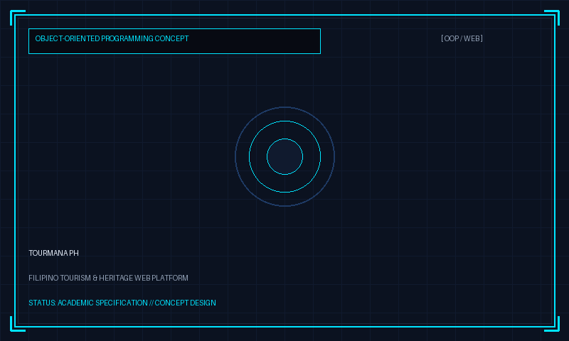

# LuckzDev Nexus Protocol
### The Next-Generation Cyberpunk Developer Portfolio



> **"Turning Real-World Problems Into Intelligent Digital Solutions."**  
> *Engineering Ideas. Designing Experiences. Building What Comes Next.*

---

## 🌟 Executive Overview

**LuckzDev Nexus Protocol** is the flagship personal developer portfolio of **Lucky Arlie T. Evangelista** (`LuckzDev`) — a Computer Engineering student at **ICCT Colleges Foundation, Inc.** specializing in frontend engineering, UI/UX design, embedded microcontroller systems, and Cisco network engineering.

Designed and engineered with an elite cyberpunk aesthetic, the portfolio merges science-fiction command centers with high-performance web engineering.

---

## 👤 Developer Profile

- **Full Name:** Lucky Arlie T. Evangelista
- **Handle:** `LuckzDev`
- **Location:** Antipolo City, Rizal, Philippines
- **Institution:** ICCT Colleges Foundation, Inc.
- **Academic Program:** Bachelor of Science in Computer Engineering (BSCOE)
- **Primary Roles:** Computer Engineering Student | Frontend Developer | UI/UX Designer | Aspiring Network Engineer
- **Future Direction:** Network Engineer (Pursuing Cisco Certified Network Associate - CCNA)

---

## 🎨 Visual Identity & Cyberpunk System

The design system adheres to a disciplined, high-contrast cyberpunk color palette:

| Token | Hex Code | Visual Application |
|---|---|---|
| **Obsidian Black** | `#070A12` | Deep interface base background |
| **Midnight Navy** | `#0B1220` | Card layers, containers & module glass |
| **Electric Cyan** | `#00E5FF` | Primary interactive accents, glowing vectors & status telemetry |
| **Neon Violet** | `#8B5CF6` | Sub-headings, transition gradients & atmospheric depth |
| **Digital Magenta** | `#FF3CAC` | Highlights, active cursor states & alert indicators |
| **Terminal Green** | `#39FF88` | System online beacons, terminal text & hardware readouts |
| **Soft White** | `#EAF2FF` | High-contrast typography & headings |
| **Muted Blue-Gray** | `#94A3B8` | Body copy, technical descriptions & secondary metadata |

---

## 🚀 Key Architectural Features

### 1. Cinematic System Boot Experience
- **Terminal Typewriter:** Displays initialization messages, kernel load simulations, and developer profile loading.
- **Robot Voice Initialization:** Announces system initialization and network setup using the browser's speech synthesizer.
- **Hologram Avatar Presentation:** Displays an abstract anonymous programmer silhouette with scanning cyan lasers and audio waveform bars.
- **Identity Reveal Transition:** Scanlines sweep across the frame, glitching the anonymous silhouette into Lucky's real verified formal portrait.
- **Non-blocking & Fast:** 1-click **[SKIP INTRO]** enters the main portfolio instantly.

### 2. AI Voice and Cyber Soundscape
- Built using the native **Web Speech API**.
- Automatically plays the one-time LUCKZDEV AI greeting after initialization, then stops; visitors can replay or stop it from the navigation control.
- The supplied HUD music theme and procedural interface sound effects default to on and share a navigation mute toggle.
- Browsers may block autoplay; the startup tone and theme start on the visitor's first interaction when required by browser policy. The boot control explicitly enables audio and replays the initialization announcement.
- Includes live voice subtitles and respects the visitor's saved sound preference.

### 3. Interactive Cyber Cursor & Canvas Atmosphere
- **Canvas Atmosphere:** Particle dust and constellation network connecting nearby nodes, paced at about 30 FPS to leave more rendering time for page interaction. Automatically pauses when the tab is hidden.
- **Contextual Cursor:** Displays reactive badges (`EXPLORE`, `INSPECT`, `ACCESS`, `TRANSMIT`) and spark bursts upon hovering interactive cards. Automatically disabled on mobile touch screens and when `prefers-reduced-motion` is enabled.

### 4. Featured Academic Systems & Conceptual Proposals
Transparent, academic specifications with zero exaggerated claims:
1. **TourMana PH** — Proposed OOP web platform for Filipino tourism and cultural heritage discovery.
2. **Portable Water Filter & Safety Monitoring System** — Embedded hardware prototype combining pH, turbidity, TDS, and temperature sensors with automated pump relays.
3. **ICCTskolar** — Mobile scholarship discovery and deadline tracking application proposal for ICCT students.
4. **Self-Service Printing Kiosk with Hybrid Payment** — Academic capstone thesis designing an automated document printing kiosk with cash and digital payment options.

### 5. Cisco Networking Simulator
- Interactive Layer 2 & Layer 3 topology featuring an Edge Router, Distribution Switch, and Endpoints (Admin PC, Server, IoT Node).
- Animated moving data packets traversing links; the simulation pauses while off-screen and resumes when visible.
- Interactive node inspector explaining routing tables, VLAN segmentation, and subnetting mathematics.
- Educational **[TRANSMIT PACKET]** and **[RESET TOPOLOGY]** actions.

### 6. Verified Credentials & Academic Recognition
- Dedicated lightbox document gallery displaying 8 authentic records:
  1. **DICT Safer Internet Day: Cybersecurity for Everyone** (Certificate ID: `DICTR4A-2026-0210-147`, Feb 10, 2026)
  2. **Advancing Secure Networking for Smart Environment: Design, Threat Modeling & Mitigation** (13th Engineering Day, March 3, 2026)
  3. **Advancing R&D in IoT for Smart Environments: Innovations and Future Directions** (12th Engineering Day, March 6, 2025)
  4. **Institute of Electronics Engineers of the Philippines (IECEP-ICCT) Chapter** (Membership ID: `2025-T3-0242`, A.Y. 2024–2025)
  5. **ICCT Engineering Society (IES) Membership — 2nd Year** (A.Y. 2024–2025 3rd Trimester, valid until June 30, 2025)
  6. **ICCT Engineering Society (IES) Membership — 1st Year** (A.Y. 2023–2024 3rd Trimester)
  7. **Institute of Computer Engineers of the Philippines (ICPEP) Chapter — 2025** (Valid until March 05, 2025)
  8. **Institute of Computer Engineers of the Philippines (ICPEP) Chapter — 2024** (Valid until November 30, 2024)

### 7. Signature Rocket Launch CTA
- The **[INITIATE EXPLORATION]** button ignites a futuristic cyber rocket with dual cyan/violet plasma trails and a screen warp ripple, smoothly guiding the user down to the projects section.

### 8. Responsive Telemetry and Browsing
- Skills and tool icons accompany a loading-animated graph of the actual skills inventory by category.
- Certificate gallery thumbnails are optimized WebP previews; opening a certificate shows its preview immediately while the full-resolution document loads, keeping the visible image available on slow connections.
- Section headers animate network telemetry as each section initializes; compact spacing and smooth free scrolling keep browsing focused.
- The scroll HUD reports progress and the current portfolio section.
- Mobile project cards use compact previews, shortened summaries, and a small set of visible technology tags; full details remain in the project view. Swipes and arrow controls trigger a restrained scan-and-verify effect, while other rails use subtle fades and respect reduced-motion settings.
- Project cards only show GitHub links when a real repository URL is configured; current academic concepts are clearly marked as having no public repository yet.

---

## 📂 Project Structure

```
CyberpunkLuckzwebport/
├── .github/
│   └── workflows/
│       └── deploy.yml            # Automated GitHub Pages CI/CD workflow
├── assets/
│   └── images/
│       ├── certificates/         # High-resolution certificate renders (8 Authentic Records)
│       │   ├── safer-internet-day-2026.png
│       │   ├── secure-networking-seminar-2026.png
│       │   ├── iot-smart-environments-seminar-2025.png
│       │   ├── iecep-student-chapter-membership.png
│       │   ├── icct-engineering-society-membership-2025.png
│       │   ├── icct-engineering-society-membership.png
│       │   ├── icpep-membership.png
│       │   └── icpep-membership-2024.png
│       ├── projects/             # High-tech conceptual schematics
│       │   ├── tourmana-preview.png
│       │   ├── water-filter-preview.png
│       │   ├── icctskolar-preview.png
│       │   └── printing-kiosk-preview.png
│       ├── favicon.svg           # Cyberpunk neon emblem favicon
│       └── luckzdev-portrait.jpg # Verified formal portrait
├── css/
│   └── style.css                 # Cyberpunk design system, responsive styles & animations
├── js/
│   ├── app.js                    # Core application orchestrator & modal controllers
│   ├── audio.js                  # Web Speech API AI voice synthesizer
│   ├── cursor.js                 # Custom interactive reactive cursor
│   ├── data.js                   # Central structured data store
│   ├── network.js                # Cisco network topology simulation engine
│   ├── particles.js              # Paced Canvas constellation & dust engine
│   └── rocket.js                 # Signature rocket launch animation
├── .gitignore
├── index.html                    # Semantic HTML5 single page application
├── package.json                  # Project manifest and local preview scripts
└── README.md                     # Engineering documentation
```

---

## 💻 Local Preview (Zero Installation Required)

Because this website uses modern web standards (HTML5, CSS3, ES6 modules), it requires **no external packages or node dependencies** to run.

### Run from VS Code

Open this project folder in VS Code, then press **Ctrl+F5** (Run Without Debugging). VS Code starts the local Python web server and opens the portfolio in Chrome. Python must be installed and available as `python` in your terminal.

### Run from a terminal

Python's built-in lightweight web server can also be started manually:

```powershell
cd C:\path\to\CyberpunkLuckzwebport
python -m http.server 8081
```

Then open **`http://127.0.0.1:8081/`** in your browser. Do not open `index.html` directly as a `file://` URL; the browser blocks the site's JavaScript modules in that mode.

---

## 🌐 Deploying to GitHub Pages

The repository comes pre-configured with a zero-friction GitHub Actions workflow (`.github/workflows/deploy.yml`):

1. **Create or rename your GitHub repository to `LuckzDev-Portfolio`, then initialize Git & push:**
   ```bash
   git init
   git add .
   git commit -m "feat: complete LuckzDev cyberpunk nexus portfolio"
   git branch -M main
   git remote add origin https://github.com/LuckzDev04/LuckzDev-Portfolio.git
   git push -u origin main
   ```

2. **Enable GitHub Pages in your Repository Settings:**
   - Go to your GitHub repository: `https://github.com/LuckzDev04/LuckzDev-Portfolio`
   - Click on **Settings** → **Pages**
   - Under **Build and deployment** → **Source**, select **GitHub Actions**
   - The included workflow will automatically build and publish your site!

Your portfolio will be live at:  
👉 **`https://luckzdev04.github.io/LuckzDev-Portfolio/`**

### Help Google discover the portfolio

GitHub Pages makes the site publicly accessible, but Google may take days or weeks to crawl and show it in search results. After the deployment succeeds:

1. Open [Google Search Console](https://search.google.com/search-console/) and add the live portfolio URL as a **URL prefix** property.
2. Verify ownership using one of the methods Search Console offers. If using its HTML file method, put the downloaded verification file in the project root and push it to `main`.
3. In Search Console, submit `https://luckzdev04.github.io/LuckzDev-Portfolio/sitemap.xml`.
4. Use **URL inspection** for the portfolio URL and select **Request indexing**.

The site includes a canonical URL, search/social metadata, structured profile data, and a sitemap. These help search engines understand the page, but do not guarantee a particular ranking or an immediate listing.

---

## 📬 Official Social Profiles

- **GitHub:** [github.com/LuckzDev04](https://github.com/LuckzDev04)
- **LinkedIn:** [linkedin.com/in/lucky-arlie-evangelista-511b0b440](https://www.linkedin.com/in/lucky-arlie-evangelista-511b0b440/)
- **Facebook:** [facebook.com/lucky.evangelista.505](https://www.facebook.com/lucky.evangelista.505)
- **Instagram:** [instagram.com/m1ng_daewoon](https://www.instagram.com/m1ng_daewoon/)
- **TikTok:** [tiktok.com/@z.luck.m1ng](https://www.tiktok.com/@z.luck.m1ng?is_from_webapp=1&sender_device=pc)
- **Email:** [luckyevangelista04@gmail.com](mailto:luckyevangelista04@gmail.com)

---

## 📄 License

Distributed under the **MIT License**. Crafted with precision by **Lucky Arlie T. Evangelista** (`LuckzDev`).
